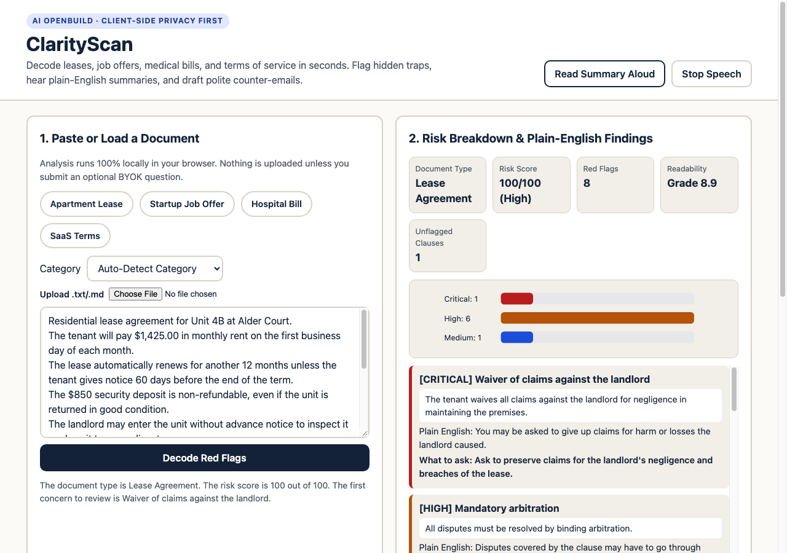
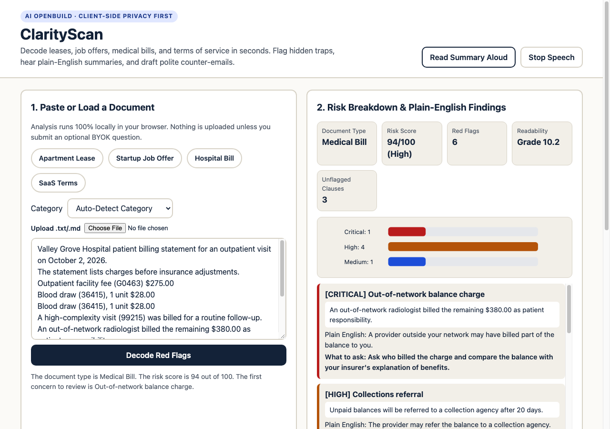
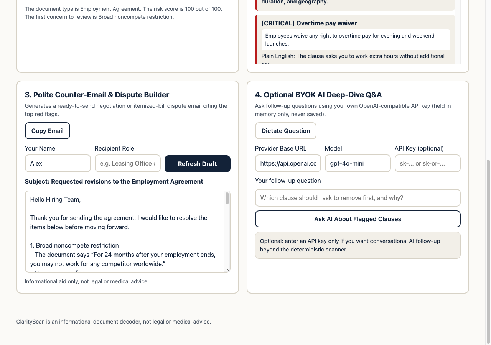

# ClarityScan

**Plain-language contract, lease, job offer, and medical bill risk decoder with polite counter-email drafting.**

- **Live site:** [https://linhnguyen-gt.github.io/clarityscan/](https://linhnguyen-gt.github.io/clarityscan/)
- **Source repository:** [https://github.com/linhnguyen-gt/clarityscan](https://github.com/linhnguyen-gt/clarityscan)
- **Target hackathon:** AI OpenBuild

ClarityScan runs 100% client-side in your browser so sensitive leases, employment contracts, and hospital invoices never leave your device unless you opt into optional BYOK AI follow-up Q&A.



## Features

- **24 Red-Flag Clause Detectors + Numeric Traps:** Covers apartment leases, job offers, medical bills, and SaaS terms of service, flagging hidden penalties, short dispute deadlines, and multi-year lock-ins.
- **Plain-English Rewrites & Spoken Summaries:** Translates dense legalese or billing jargon into calm explanations with Web Speech readback.
- **Polite Counter-Email & Dispute Builder:** Generates an editable negotiation or itemized-bill dispute email quoting the top flagged clauses, with a clear informational disclaimer.
- **Optional BYOK Deep-Dive Q&A:** Connect your own OpenAI-compatible API key in memory (never stored) to ask custom follow-up questions.

| Hospital Bill Dispute Analysis | Startup Job Offer & Counter-Draft |
| --- | --- |
|  |  |

## Verification

Tested on Node `v24.18.0` and headless Google Chrome:

```bash
node --test tests/*.test.mjs
```
